

# 🎤 SOEZ-LRC Plugin

**多功能 LRC 歌词加载插件 · VST3 · 基于 JUCE9**

[🇨🇳 中文](#lang-cn) ｜ [🇬🇧 English](#lang-en) ｜ [🇯🇵 日本語](#lang-jp) ｜ [🇰🇷 한국어](#lang-kr)

---

# 🇨🇳 SOEZ-LRC Plugin（中文）

> **SOEZ-LRC** 是一款可加载于 DAW 的多功能 LRC 歌词插件，让你在录音翻唱、舞台演出时像用 QQ 音乐 / Apple Music 一样查看歌词。
>
> - 内置 **中 / 英 / 日 / 韩** 四语言（默认中文）
> - 支持 **局域网歌词预览**（平板、手机随时看词）
> - 基于 **[JUCE9]** 开发的 **VST3** 插件
>
> ⚖️ 使用前请阅读开源协议：**GNU Affero General Public License v3.0**
> 🚧 开发版本持续更新中，欢迎提交 bug 或建议反馈！

### 📖 使用说明

**目录**

| # | 章节 |
|---|---|
| 1 | [基础介绍](#cn-基础介绍) |
| 2 | [导入](#cn-导入) |
| 3 | [起点定位](#cn-起点定位) |
| 4 | [延迟调整](#cn-延迟调整) |
| 5 | [跟随（原始 LRC 歌词时间）](#cn-跟随) |
| 6 | [LRC 时间与 BPM 跟随](#cn-bpm) |
| 7 | [局域网功能](#cn-局域网) |
| 8 | [高亮颜色设置](#cn-颜色) |
| 9 | [语言设置](#cn-语言) |
| 10 | [歌词缩放与界面缩放](#cn-缩放) |
| 11 | [清空歌词](#cn-清空) |

---

### 🧩 基础介绍

本插件可加载于 **DAW**（Digital Audio Workstation，支持 VST3 插件的数字音频工作站），为你提供一个类似 QQ 音乐 / Apple Music 的歌词显示页面，让你在翻唱录音、舞台演出时轻松查看歌词。

主要特性：

- 🌐 **四语言界面**：中文 / 英文 / 日文 / 韩文
- 💡 **引导提示**：鼠标悬停在任意按钮上即可看到功能说明
- 📡 **局域网共享**：现场的朋友用平板、手机扫码（QR 码）或复制局域网链接，即可实时查看歌词
- 🎨 **自定义高亮颜色**：歌词颜色随你喜好
- ✏️ **实时编辑**：随时修改歌词内容
- 💾 **自动存档**：设置随 DAW 工程文件一起保存，下次打开无需重新导入与配置

---

### 📥 导入

安装完插件后，请确保你的宿主软件（DAW）已成功扫描到 **SOEZ-LRC**。

加载插件后，主界面如下图所示。你可以通过 **拖拽** / **点击** / **右键菜单** 导入你准备好的 LRC 歌词文件。

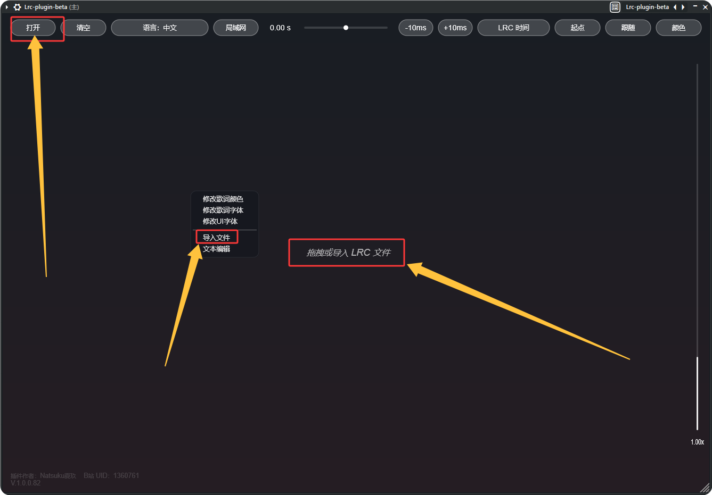

---

### 🎯 起点定位

歌词加载完成后，需要手动定位到当前音频文件 / 歌词文件的**开头位置**，如下图所示。

这样可以保证播放音频时歌词 **100% 同步**。

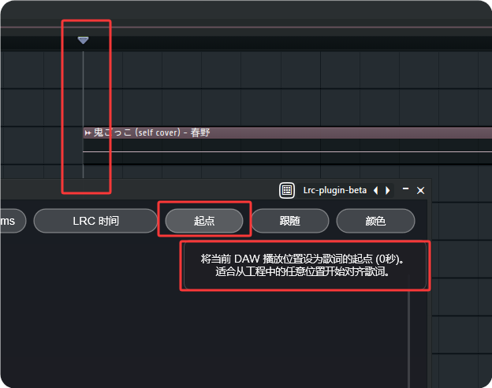

---

### ⏱️ 延迟调整

如果点击「起点」后仍感觉歌词有延迟，可以：

- 点击 **+10ms / -10ms** 微调延迟
- 拖动滑块，或 **双击** 延迟数值手动输入精确数值
- 调整过度想归零？**双击滑块** 即可恢复为 0s

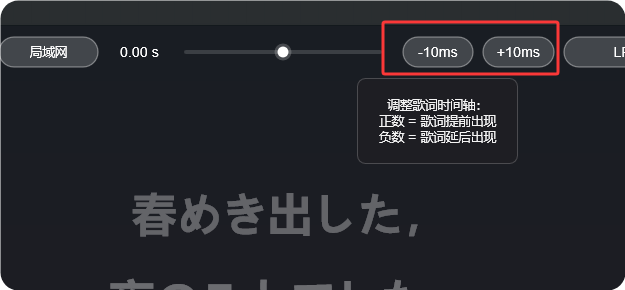

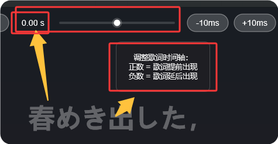

---

### 🔁 跟随（原始 LRC 歌词时间）

想让歌词从 LRC 文件最原始的时间点开始预览？点击 **「跟随」** 按钮即可恢复全局时间轴，如下图所示。

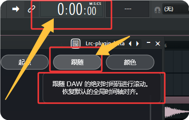

---

### 🥁 LRC 时间与 BPM 跟随

插件提供两种时间模式：

- **LRC 时间模式**（默认）：按 LRC 原始时间轴播放。定位开头就相当于视频剪辑里「拖动素材起点」，播放速度不变。
- **BPM 模式**（跟随宿主 BPM）：点击 **「LRC 时间」** 按钮，**绿灯亮起** 即进入 BPM 模式，插件会锁定并跟随 DAW 的 BPM 速度。

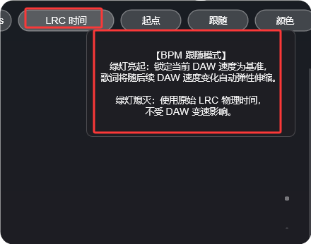

在 BPM 模式下随意调整你的 BPM，插件都会实时跟随。⚠️ 注意：目前仍存在 **10~50ms 的延迟误差**，可能需要手动校准，或重新定位起点。

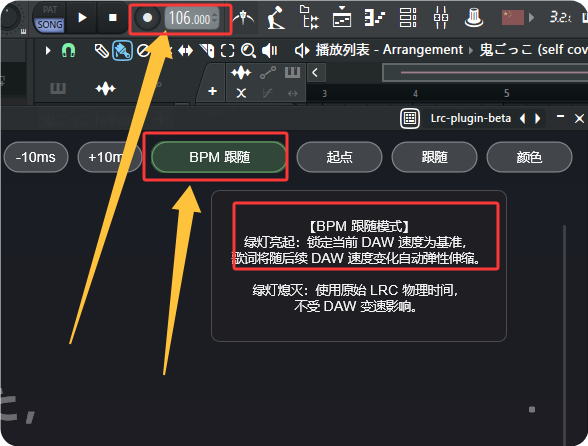

---

### 📡 局域网功能

局域网共享功能可以让你和现场的朋友通过 **平板、手机、电脑** 等设备连接（支持局域网直连或开放端口映射远程连接）：

- 扫码（QR 码）或复制插件生成的局域网链接，即可打开网页实时查看歌词
- 网页端独立支持 **四语言切换** 与 **独立延迟校准**
- 插件端与网页端均可缩放歌词大小

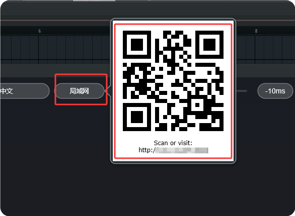

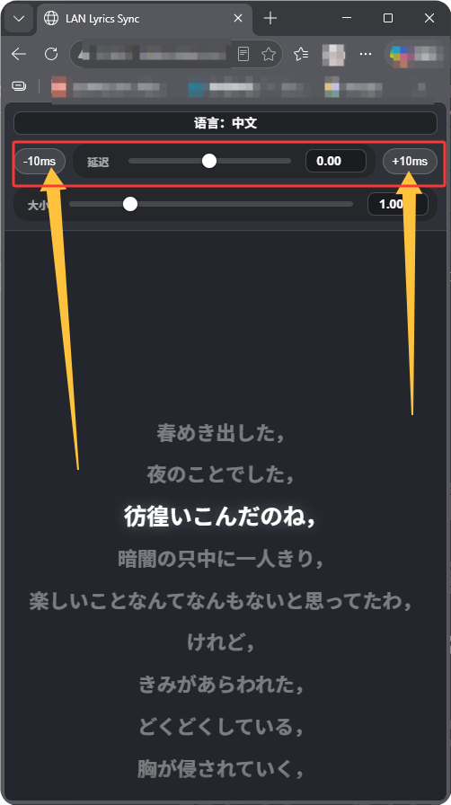

---

### 🎨 高亮颜色设置

点击左上角的颜色按钮，或右键菜单中的 **「修改歌词颜色」**，即可修改歌词高亮颜色（默认为**白色高亮**）。

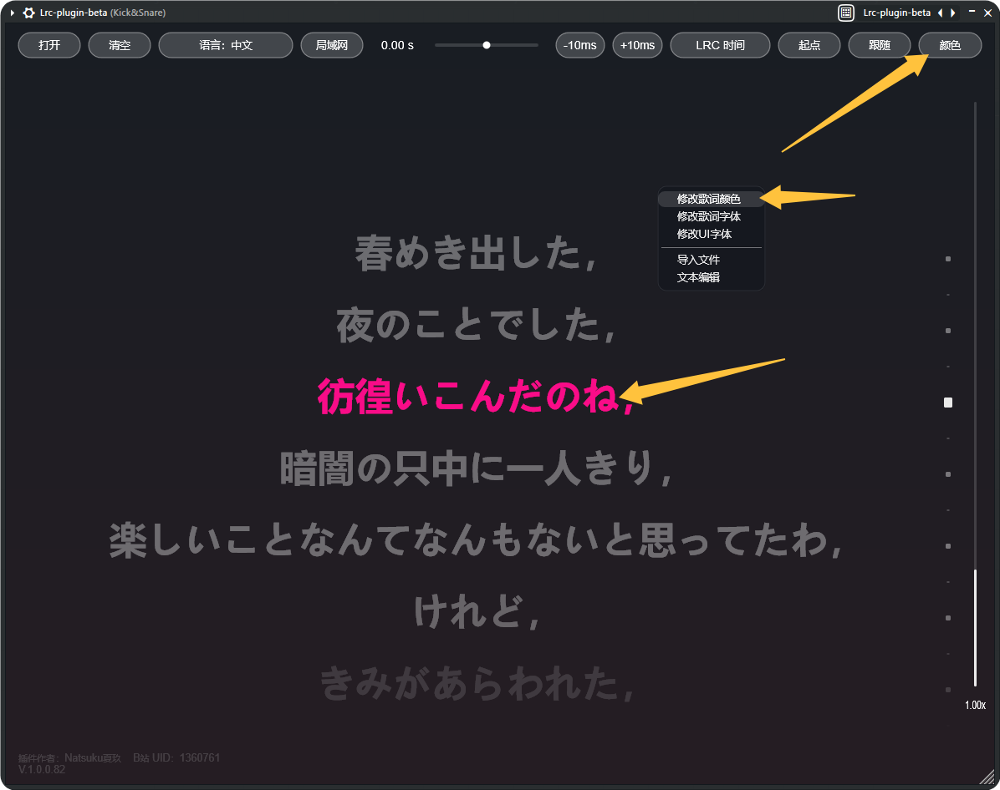

---

### 🌐 语言设置

点击 **「语言：当前语言」** 即可切换其他语言。默认语言与局域网页面同步，但局域网页面提供**独立**的语言修改选项。

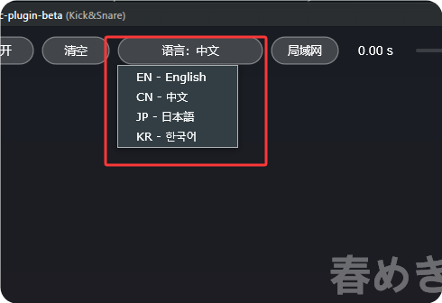

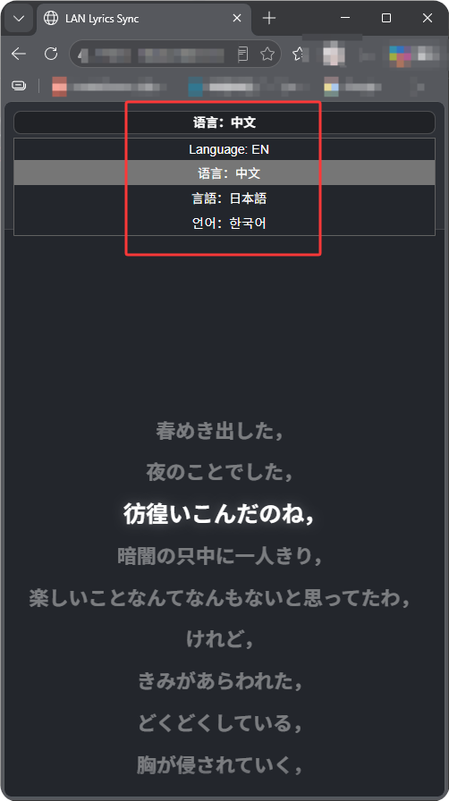

---

### 🔍 歌词缩放与界面缩放

**歌词大小**

- 拖动右侧长条即可缩放歌词
- **双击 `1.00x`** 数字可自定义输入数值
- **右键双击** 长条即可恢复默认大小

**插件界面大小**

窗口右下角支持自由拖动，随时调整插件窗口大小。

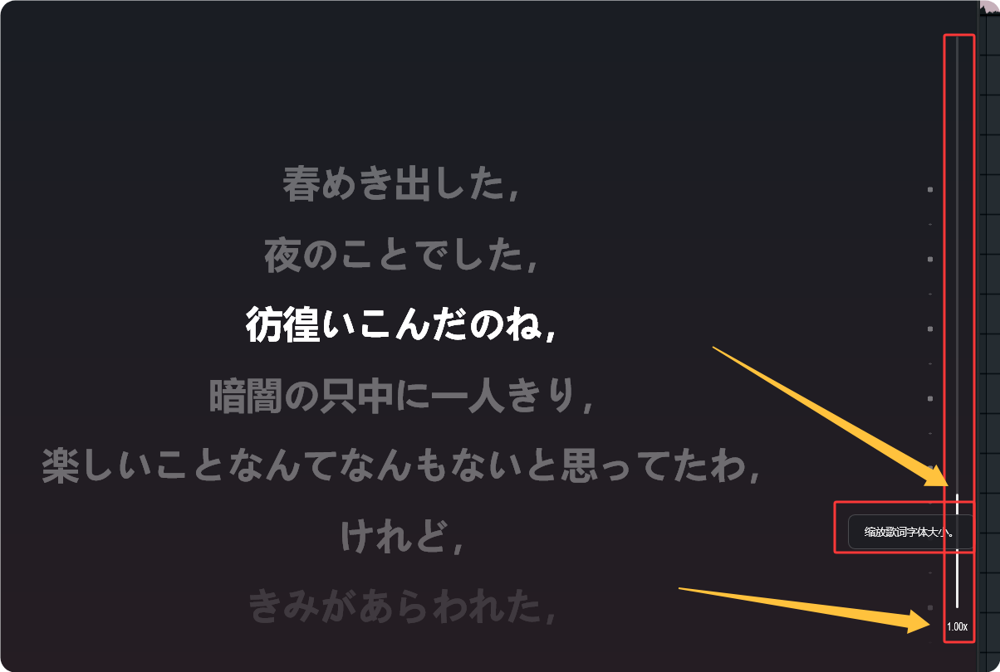

---

### 🗑️ 清空歌词

点击 **「清空」** 即可清除当前加载的歌词，如下图所示。

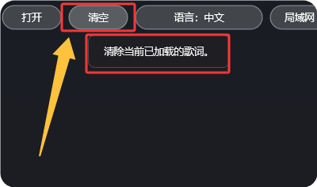

[⬆ 返回顶部](#lang-cn)

---

# 🇬🇧 SOEZ-LRC Plugin (English)

> **SOEZ-LRC** is a multi-purpose LRC lyrics plugin that loads into your DAW, giving you a QQ Music / Apple Music–style lyric view during recording, cover singing, and live stage performances.
>
> - **Four UI languages**: Chinese / English / Japanese / Korean (Chinese by default)
> - **LAN lyrics preview** on tablets and phones
> - **VST3** plugin built on **[JUCE9]**
>
> ⚖️ Licensed under **GNU Affero General Public License v3.0**
> 🚧 Actively in development — bug reports and ideas are welcome!

### 📖 User Guide

**Table of Contents**

| # | Section |
|---|---|
| 1 | [Basic Introduction](#en-basic-introduction) |
| 2 | [Import](#en-import) |
| 3 | [Start-Point Positioning](#en-start-point-positioning) |
| 4 | [Delay Adjustment](#en-delay-adjustment) |
| 5 | [Follow (Original LRC Lyrics Time)](#en-follow) |
| 6 | [LRC Time & BPM Follow](#en-bpm) |
| 7 | [LAN Function](#en-lan-function) |
| 8 | [Highlight Color Settings](#en-highlight-color-settings) |
| 9 | [Language Settings](#en-language-settings) |
| 10 | [Lyrics Scaling & UI Scaling](#en-scaling) |
| 11 | [Clear Lyrics](#en-clear-lyrics) |

---

### 🧩 Basic Introduction

This plugin loads into a **DAW** (Digital Audio Workstation that supports VST3 plugins) and provides a lyrics page similar to QQ Music / Apple Music — perfect for recording cover songs or checking lyrics during live performance.

Key features:

- 🌐 **Four-language UI**: Chinese / English / Japanese / Korean
- 💡 **Tooltip guides**: hover over any button to see what it does
- 📡 **LAN sharing**: friends on site scan the QR code or copy the LAN link to view lyrics in real time on tablets or phones
- 🎨 **Customizable highlight color**
- ✏️ **Real-time lyric editing**
- 💾 **Auto-save**: settings are stored with your DAW project — no re-importing next time

---

### 📥 Import

After installation, make sure your host (DAW) has scanned the **SOEZ-LRC** plugin.

Load the plugin — the main interface is shown below. Import your LRC lyrics by **drag & drop**, **click**, or **right-click menu**.

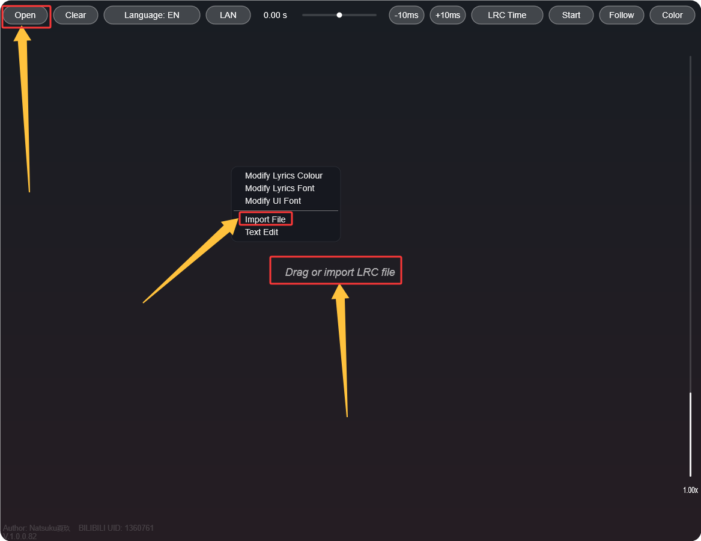

---

### 🎯 Start-Point Positioning

Once lyrics are loaded, manually set the **start point** of the current audio / lyrics file, as shown below.

This ensures the lyrics stay **100% in sync** with playback.

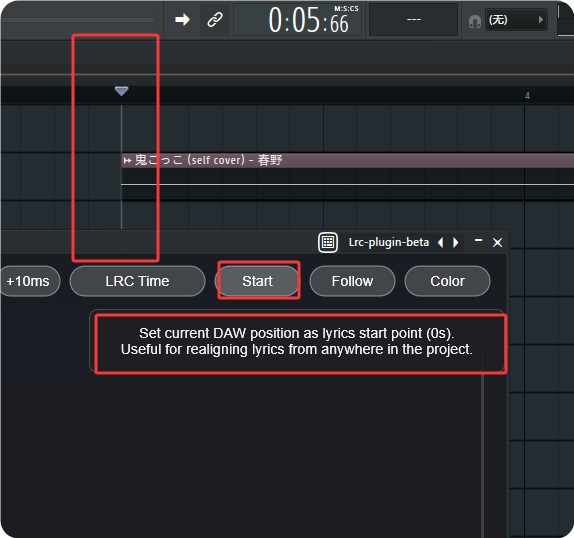

---

### ⏱️ Delay Adjustment

If lyrics still feel slightly off after setting the start point:

- Click **+10ms / -10ms** for fine adjustment
- Drag the slider, or **double-click** the value to type an exact delay
- Over-adjusted? **Double-click the slider** to reset to 0s

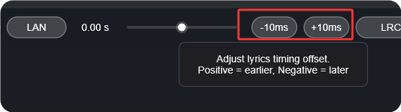

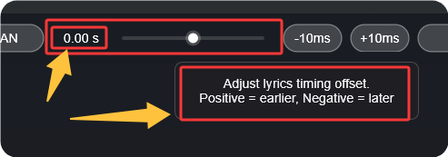

---

### 🔁 Follow (Original LRC Lyrics Time)

Want the preview to start from the very beginning of the LRC's original timeline? Click **"Follow"** to restore the global timeline, as shown below.

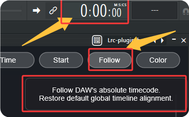

---

### 🥁 LRC Time & BPM Follow

Two timing modes are available:

- **LRC Time mode** (default): plays along the original LRC timeline. Setting the start point is like dragging a clip's start in video editing — playback speed stays the same.
- **BPM mode (follow host BPM)**: click the **"LRC Time"** button — when the **green light turns on**, the plugin is locked to and follows your DAW's BPM.

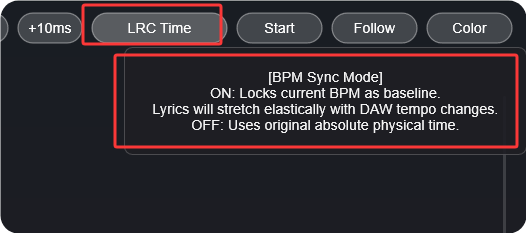

In BPM mode, feel free to change your BPM — the plugin follows in real time. ⚠️ Note: a **10–50 ms timing error** may still exist; manual calibration or re-setting the start point may be needed.

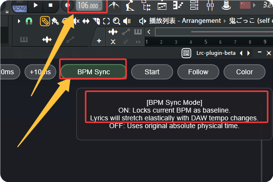

---

### 📡 LAN Function

The LAN sharing feature lets you and your friends on site connect via **tablets, phones, or computers** (LAN direct, or port-mapped remote connections):

- Scan the QR code or copy the plugin's LAN link to open the web page and view lyrics in real time
- The web page has its own **four-language switch** and **per-device delay calibration**
- Lyrics size can be scaled both in the plugin and on the web page

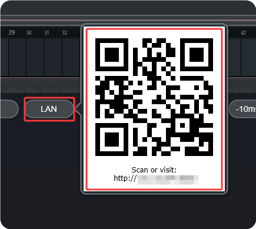

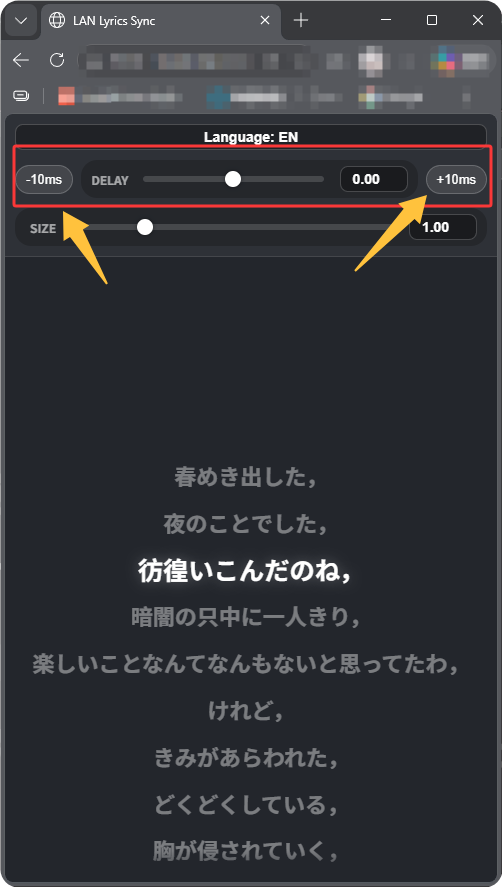

---

### 🎨 Highlight Color Settings

Click the color button in the upper-left corner, or use **"Edit Lyrics Color"** in the right-click menu to change the highlight color (default: **white highlight**).

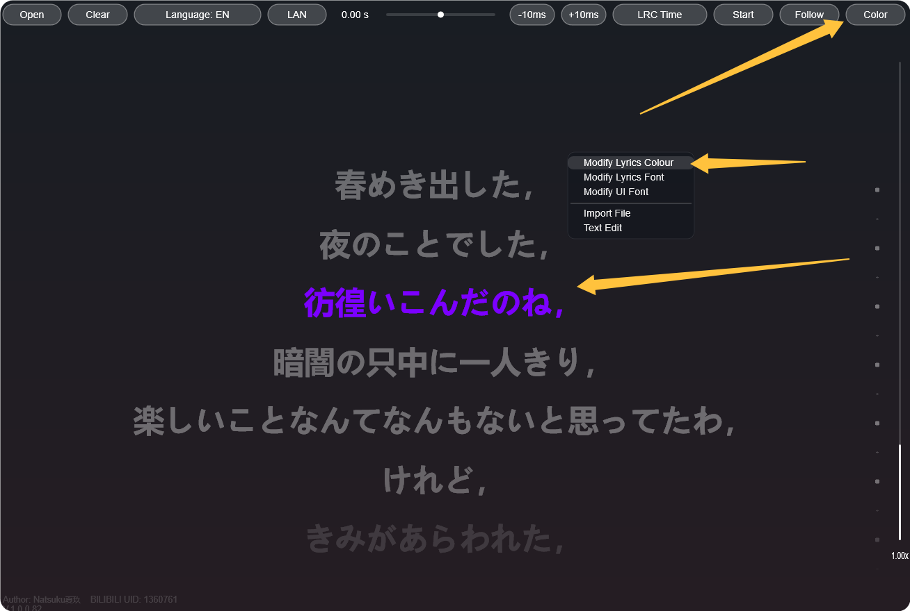

---

### 🌐 Language Settings

Click **"Language: current language"** to switch languages. The default language is shared with the LAN page, but the LAN page also offers an **independent** language setting.

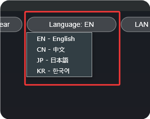

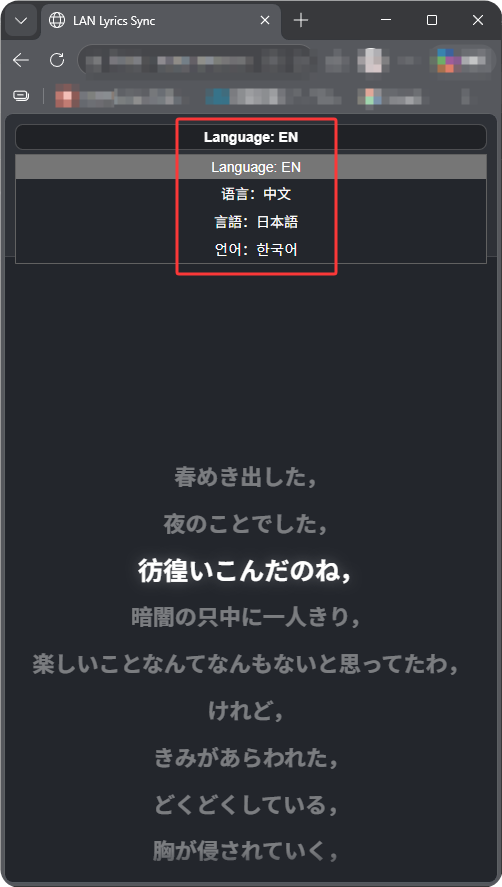

---

### 🔍 Lyrics Scaling & UI Scaling

**Lyrics size**

- Drag the long bar on the right to scale
- **Double-click `1.00x`** to type a custom value
- **Right-click double-click** the bar to reset to default size

**Plugin window size**

Drag the bottom-right corner of the window to freely resize the plugin UI.

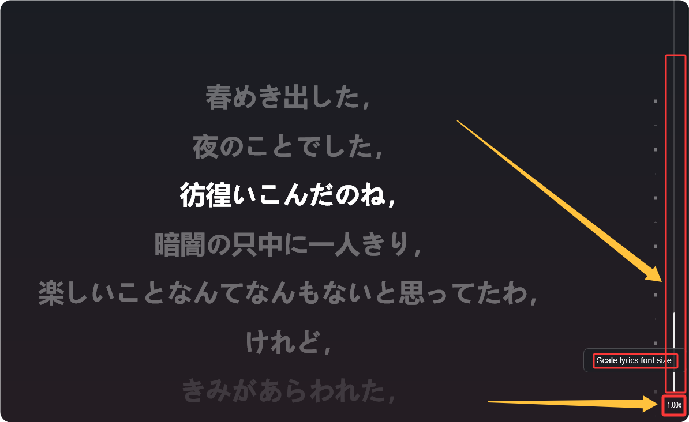

---

### 🗑️ Clear Lyrics

Click **"Clear"** to remove the currently loaded lyrics, as shown below.

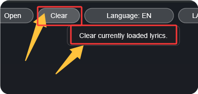

[⬆ Back to top](#lang-en)

---

# 🇯🇵 SOEZ-LRC Plugin（日本語）

> **SOEZ-LRC** は、DAW に読み込んで使用する多機能 LRC 歌詞プラグインです。QQ 音楽 / Apple Music のような歌詞画面を表示し、カバー歌唱の録音やステージ演奏時に便利です。
>
> - **4 言語 UI**：中国語 / 英語 / 日本語 / 韓国語（デフォルトは中国語）
> - **LAN 歌詞プレビュー**（タブレット・スマホ対応）
> - **[JUCE9]** ベースの **VST3** プラグイン
>
> ⚖️ ライセンス：**GNU Affero General Public License v3.0**
> 🚧 開発版は継続更新中です。バグ報告・アイデアは大歓迎！

### 📖 使用方法

**目次**

| # | セクション |
|---|---|
| 1 | [基本紹介](#jp-基本紹介) |
| 2 | [読み込み](#jp-読み込み) |
| 3 | [開始位置の指定](#jp-開始位置の指定) |
| 4 | [遅延調整](#jp-遅延調整) |
| 5 | [フォロー（元の LRC 歌詞タイム）](#jp-フォロー) |
| 6 | [LRC タイムと BPM フォロー](#jp-bpm) |
| 7 | [LAN 機能](#jp-lan機能) |
| 8 | [ハイライト色の設定](#jp-ハイライト) |
| 9 | [言語設定](#jp-言語設定) |
| 10 | [歌詞サイズと UI サイズの調整](#jp-スケーリング) |
| 11 | [歌詞のクリア](#jp-歌詞のクリア) |

---

### 🧩 基本紹介

本プラグインは、**DAW**（Digital Audio Workstation、VST3 対応）に読み込んで使用します。QQ 音楽 / Apple Music のような歌詞画面を提供し、カバー歌唱の録音やステージ演奏時の歌詞確認に最適です。

主な機能：

- 🌐 **4 言語 UI**：中国語 / 英語 / 日本語 / 韓国語
- 💡 **ツールチップガイド**：ボタンにマウスを乗せると説明が表示されます
- 📡 **LAN 共有**：QR コードをスキャンするか LAN リンクをコピーするだけで、タブレットやスマホでリアルタイムに歌詞を閲覧可能
- 🎨 **ハイライト色のカスタマイズ**
- ✏️ **リアルタイム歌詞編集**
- 💾 **自動保存**：設定は DAW プロジェクトと一緒に保存され、次回開く際の再読み込み・再設定は不要

---

### 📥 読み込み

インストール後、ホストソフト（DAW）が **SOEZ-LRC** プラグインをスキャン済みであることを確認してください。

プラグインをロードすると、メイン画面が表示されます。**ドラッグ & ドロップ** / **クリック** / **右クリックメニュー** から、作成済みの LRC 歌詞を読み込めます。

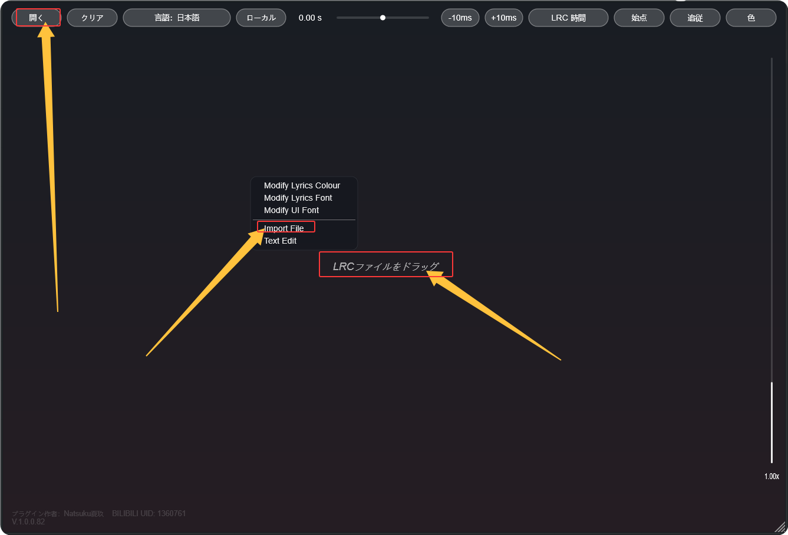

---

### 🎯 開始位置の指定

歌詞の読み込み後、現在のオーディオファイル／歌詞ファイルの**先頭位置**を手動で指定します（下図参照）。

これにより、再生時に歌詞が **100% 同期** されます。

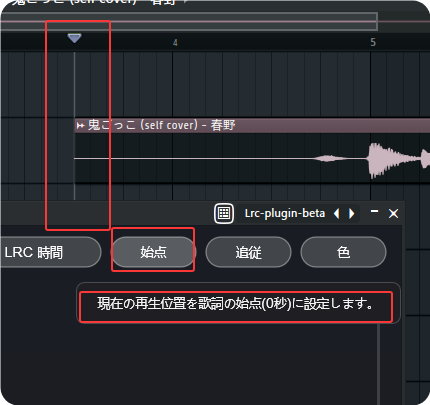

---

### ⏱️ 遅延調整

「開始位置」指定後もズレを感じる場合：

- **+10ms / -10ms** をクリックして微調整
- スライダーをドラッグ、または数値を**ダブルクリック**して直接入力
- 調整しすぎた場合は **スライダーをダブルクリック** で 0s にリセット

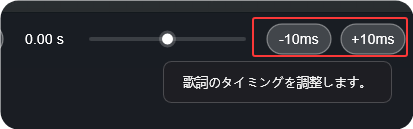

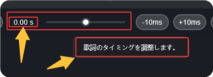

---

### 🔁 フォロー（元の LRC 歌詞タイム）

LRC 本来のタイムラインどおりに最初からプレビューしたい場合は、**「フォロー」** ボタンをクリックして全体タイムラインに戻します（下図参照）。

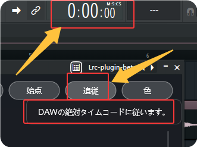

---

### 🥁 LRC タイムと BPM フォロー

タイミングモードは 2 種類あります：

- **LRC タイムモード**（デフォルト）：LRC 本来のタイムラインで再生。開始位置の指定は、動画編集で「クリップの先頭を動かす」のと同じで、再生速度は変わりません。
- **BPM モード（ホスト BPM フォロー）**：**「LRC タイム」** ボタンをクリックし、**緑ランプが点灯** すると BPM モードに入り、DAW の BPM にロックして追従します。

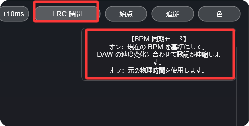

BPM モードでは BPM を自由に変更しても、リアルタイムに追従します。⚠️ ただし現状 **10〜50ms 程度の誤差** が残ります。必要に応じて手動調整、または開始位置を再指定してください。

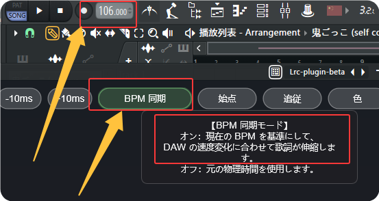

---

### 📡 LAN 機能

LAN 共有機能により、ご本人や会場の友人が **タブレット・スマホ・PC** で接続できます（LAN 直結、またはポートマッピングによるリモート接続対応）：

- QR コードをスキャン、またはプラグインの LAN リンクをコピーして、Web ページでリアルタイムに歌詞を表示
- Web ページ側は独立した **4 言語切替** と **デバイスごとの遅延キャリブレーション** に対応
- 歌詞サイズはプラグイン側・Web ページ側の両方で調整可能

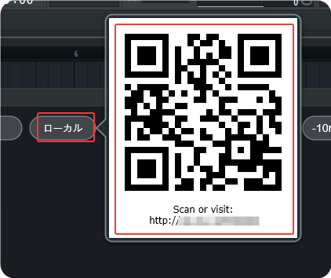

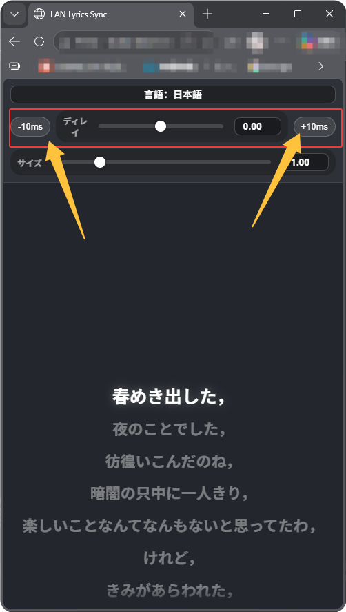

---

### 🎨 ハイライト色の設定

左上の色ボタンをクリック、または右クリックメニューの **「歌詞の色を変更」** から、歌詞のハイライト色を変更できます（デフォルトは**白**）。

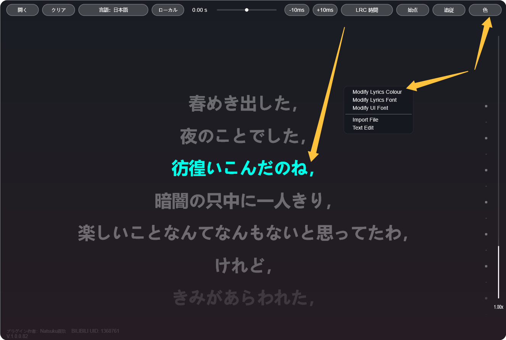

---

### 🌐 言語設定

**「言語：現在の言語」** をクリックすると他の言語に切り替えられます。デフォルトの言語は LAN ページと同期しますが、LAN ページでは**独立した**言語設定も可能です。

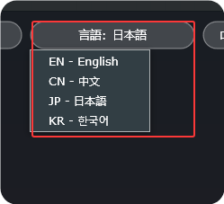

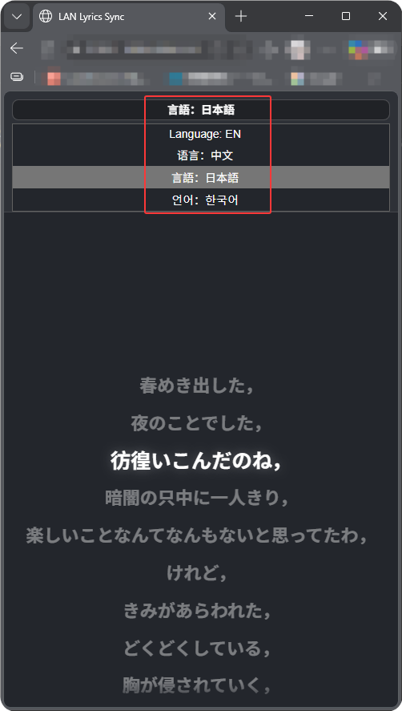

---

### 🔍 歌詞サイズと UI サイズの調整

**歌詞サイズ**

- 右側の長いバーをドラッグしてサイズ変更
- **`1.00x` をダブルクリック** すると数値を直接入力可能
- バーを **右クリックでダブルクリック** すると初期サイズに戻ります

**プラグイン UI サイズ**

ウィンドウ右下をドラッグして、自由にウィンドウサイズを変更できます。

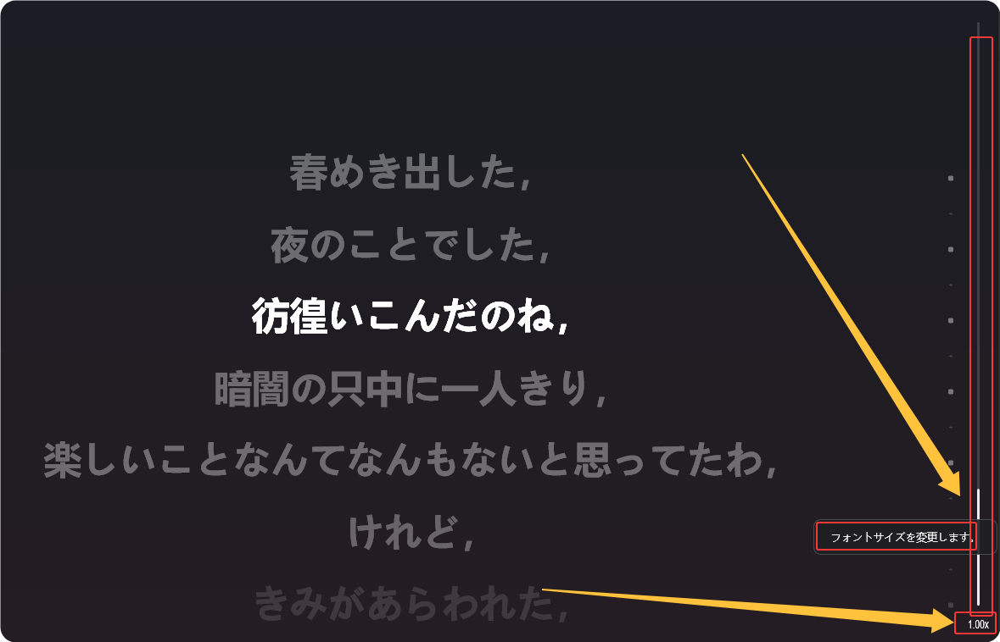

---

### 🗑️ 歌詞のクリア

**「クリア」** をクリックすると、現在読み込まれている歌詞を消去できます（下図参照）。

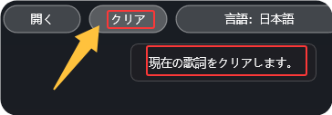

[⬆ トップへ戻る](#lang-jp)

---

# 🇰🇷 SOEZ-LRC Plugin (한국어)

> **SOEZ-LRC**는 DAW에 로드하여 사용하는 다기능 LRC 가사 플러그인입니다. QQ뮤직 / Apple Music과 같은 가사 화면을 제공하여 커버 녹음과 무대 공연 시 가사를 확인하기 편리합니다.
>
> - **4개 언어 UI**: 중국어 / 영어 / 일본어 / 한국어 (기본값 중국어)
> - **LAN 가사 미리보기** (태블릿·스마트폰 지원)
> - **[JUCE9]** 기반 **VST3** 플러그인
>
> ⚖️ 라이선스: **GNU Affero General Public License v3.0**
> 🚧 개발 버전은 지속적으로 업데이트 중입니다. 버그 제보와 아이디어를 환영합니다!

### 📖 사용 설명

**목차**

| # | 섹션 |
|---|---|
| 1 | [기본 소개](#kr-기본-소개) |
| 2 | [가져오기](#kr-가져오기) |
| 3 | [시작점 지정](#kr-시작점-지정) |
| 4 | [지연 조정](#kr-지연-조정) |
| 5 | [팔로우 (원본 LRC 가사 시간)](#kr-팔로우) |
| 6 | [LRC 시간 및 BPM 팔로우](#kr-bpm) |
| 7 | [LAN 기능](#kr-lan-기능) |
| 8 | [하이라이트 색상 설정](#kr-하이라이트) |
| 9 | [언어 설정](#kr-언어-설정) |
| 10 | [가사 크기 및 UI 크기 조정](#kr-스케일링) |
| 11 | [가사 지우기](#kr-가사-지우기) |

---

### 🧩 기본 소개

본 플러그인은 **DAW** (Digital Audio Workstation, VST3 지원)에 로드하여 QQ뮤직 / Apple Music과 유사한 가사 화면을 제공하는 다기능 도구입니다. 커버 녹음이나 무대 공연 시 가사를 확인하기에 적합합니다.

주요 기능:

- 🌐 **4개 언어 UI**: 중국어 / 영어 / 일본어 / 한국어
- 💡 **툴팁 안내**: 버튼 위에 마우스를 올리면 기능 설명이 표시됩니다
- 📡 **LAN 공유**: QR 코드 스캔 또는 LAN 링크 복사만으로 태블릿·스마트폰에서 실시간 가사 확인
- 🎨 **하이라이트 색상 사용자 지정**
- ✏️ **실시간 가사 편집**
- 💾 **자동 저장**: 설정이 DAW 프로젝트와 함께 저장되어 다음 실행 시 재설정 불필요

---

### 📥 가져오기

설치 후 호스트 소프트웨어(DAW)가 **SOEZ-LRC** 플러그인을 스캔했는지 확인하세요.

플러그인을 로드하면 메인 화면이 나타납니다. **드래그 앤 드롭** / **클릭** / **우클릭 메뉴** 로 제작한 LRC 가사를 불러올 수 있습니다.

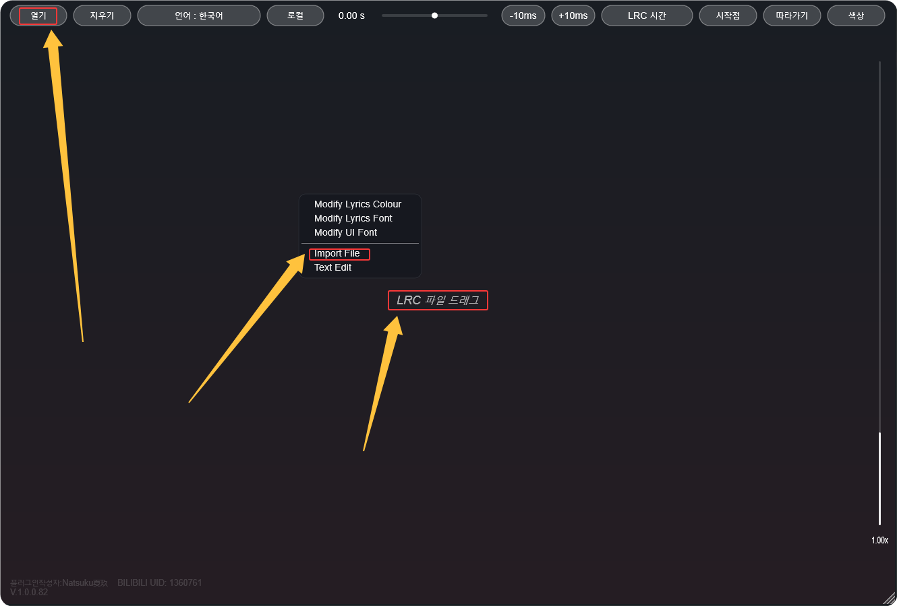

---

### 🎯 시작점 지정

가사를 불러온 후 현재 오디오 파일 / 가사 파일의 **시작 위치**를 수동으로 지정해야 합니다 (아래 그림 참조).

이렇게 하면 재생 시 가사가 **100% 동기화**됩니다.

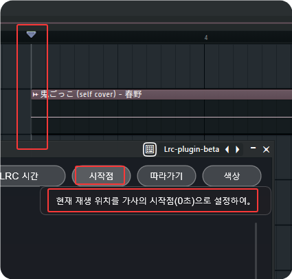

---

### ⏱️ 지연 조정

「시작점」 지정 후에도 가사가 살짝 어긋난다면:

- **+10ms / -10ms** 를 클릭해 미세 조정
- 슬라이더를 드래그하거나, 지연 값을 **더블클릭** 하여 직접 입력
- 과도하게 조정했다면 **슬라이더를 더블클릭** 하여 0s로 초기화

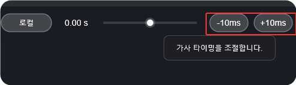

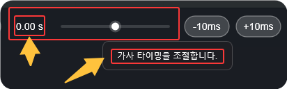

---

### 🔁 팔로우 (원본 LRC 가사 시간)

LRC 원본 타임라인의 처음부터 가사 미리보기를 보고 싶다면 **「팔로우」** 버튼을 클릭해 전체 타임라인으로 복원하세요 (아래 그림 참조).

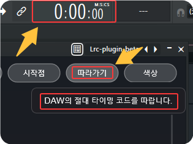

---

### 🥁 LRC 시간 및 BPM 팔로우

두 가지 타이밍 모드를 제공합니다:

- **LRC 시간 모드** (기본값): LRC 원본 타임라인을 따라 재생됩니다. 시작점 지정은 영상 편집에서 "클립 시작점을 옮기는" 것과 같으며, 재생 속도는 그대로 유지됩니다.
- **BPM 모드 (호스트 BPM 팔로우)**: **「LRC 시간」** 버튼을 클릭하여 **녹색 램프가 켜지면** BPM 모드로 진입하며, DAW의 BPM에 고정되어 따라갑니다.

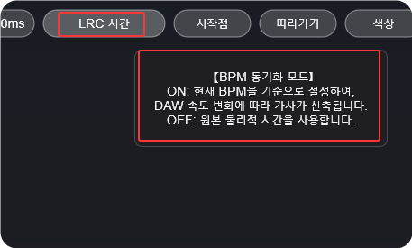

BPM 모드에서는 BPM을 자유롭게 변경해도 실시간으로 따라옵니다. ⚠️ 단, 현재 **10~50ms 정도의 오차**가 남아 있을 수 있으며, 필요 시 수동 보정 또는 시작점 재지정을 권장합니다.

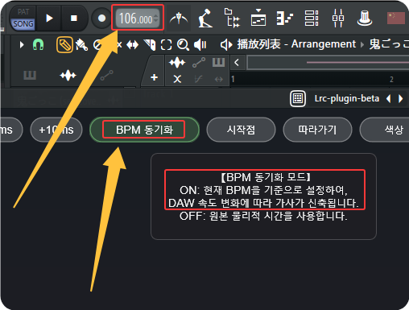

---

### 📡 LAN 기능

LAN 공유 기능을 통해 본인과 현장의 친구가 **태블릿·스마트폰·PC** 로 접속할 수 있습니다 (LAN 직결 또는 포트 매핑을 통한 원격 연결 지원):

- QR 코드를 스캔하거나 플러그인의 LAN 링크를 복사하여 웹 페이지에서 실시간 가사 확인
- 웹 페이지에서 **4개 언어 전환**과 **기기별 지연 보정**을 독립적으로 지원
- 가사 크기는 플러그인과 웹 페이지 양쪽에서 조정 가능

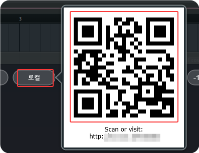

---

### 🎨 하이라이트 색상 설정

왼쪽 상단의 색상 버튼을 클릭하거나 우클릭 메뉴의 **「가사 색상 변경」** 을 선택하면 가사 하이라이트 색상을 변경할 수 있습니다 (기본값: **흰색**).

---

### 🌐 언어 설정

**「언어: 현재 언어」** 를 클릭하면 다른 언어로 전환할 수 있습니다. 기본 언어는 LAN 페이지와 동기화되지만, LAN 페이지에서는 **독립적**인 언어 설정도 가능합니다.

---

### 🔍 가사 크기 및 UI 크기 조정

**가사 크기**

- 오른쪽 긴 바를 드래그하여 크기 조정
- **`1.00x` 를 더블클릭** 하면 원하는 값을 직접 입력
- 바를 **우클릭 더블클릭** 하면 기본 크기로 복원

**플러그인 UI 크기**

창 오른쪽 아래 모서리를 드래그하여 플러그인 창 크기를 자유롭게 조정할 수 있습니다.

---

### 🗑️ 가사 지우기

**「지우기」** 를 클릭하면 현재 로드된 가사를 지울 수 있습니다 (아래 그림 참조).

[⬆ 맨 위로](#lang-kr)

---

## 📄 License

Licensed under the **GNU Affero General Public License v3.0** — see [LICENSE](LICENSE) for details.

Made with ❤️ using [JUCE](https://juce.com/)

